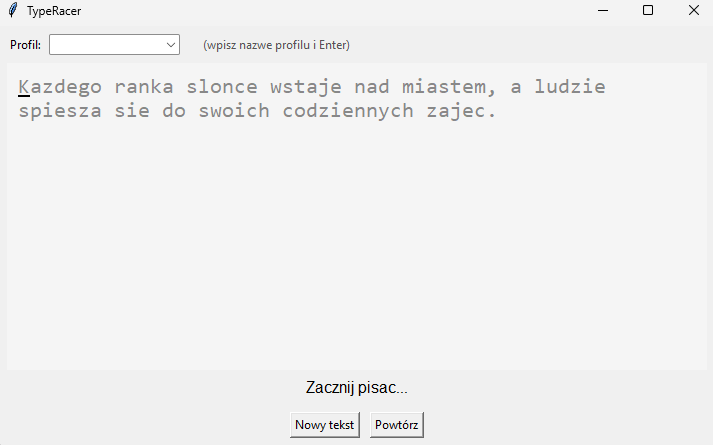

# AuthTrace
AuthTrace jest to aplikacja weryfikująca tożsamość użytkownika na podstawie charakteru pracy w systemie operacyjnym. Ma umożliwiać tworzenie profilu użytkownika i douczanie w razie potrzeby. Głównym trybem po zbudowaniu profilu jest analiza podejmowanych działań i automatyczne wylogowanie w momencie podejrzenia nieautoryzowanego dostępu.

System składa się z modułu zbierania danych (collector, zintegrowany z aplikacją TypeRacer) oraz modułu trenowania (`train.py`). W przyszłości zostanie rozszerzony o `verify.py`, który będzie odpowiedzialny za faktyczne sprawdzanie użytkownika.

Opis i uzasadnienie przebudowy projektu: [ZMIANY.md](ZMIANY.md).

## Instalacja

    pip install -r requirements.txt

## Struktura

```
AuthTrace/
├── main.py            # START: TypeRacer + collector (GUI)
├── collector.py       # collector w konsoli (swobodne pisanie, --reextract)
├── train.py           # trening modelu One-Class SVM
├── authtrace/         # rdzeń: zbieranie danych
│   ├── config.py      #   ścieżki i progi
│   ├── backends.py    #   pynput (Win/macOS/X11) i evdev (Wayland)
│   ├── features.py    #   ekstrakcja cech (jedna wersja)
│   ├── session.py     #   sesja: start / pauza / zapis
│   └── profiles.py    #   profil = katalog data/<nazwa>
├── typeracer/         # interfejs do przepisywania tekstów
├── tests/             # python -m unittest discover tests
├── data/<profil>/     # raw_session_N.json, features_session_N.json
└── models/<profil>/   # model.pkl, scaler.pkl
```

## Zbieranie danych — TypeRacer (zalecane)

    python main.py

1. W polu **Profil** wybierz istniejący profil albo wpisz nową nazwę i naciśnij Enter (tworzy katalog `data/<nazwa>`).
2. Przepisz tekst. Kropka ● przy pasku sesji jest czerwona, gdy collector nagrywa.
3. Po przepisaniu tekstu do końca sesja zapisuje się automatycznie jako kolejna (`sesja #N`).

Nagrywanie jest wstrzymane, gdy okno nie ma fokusu, gdy wpisujesz nazwę profilu i po zakończeniu tekstu. Przerwany tekst (Nowy tekst / Powtórz w trakcie) nie jest zapisywany. Tryb „jedna sesja = wiele tekstów” włącza się w `typeracer/config.py` (`SESSION_PER_TEXT = False`).

Linux/Wayland: `python main.py --backend evdev` (użytkownik musi być w grupie `input`: `sudo usermod -aG input $USER`, potem ponowne zalogowanie). Nie uruchamiaj GUI przez `sudo`.

## Zbieranie danych — konsola

    python collector.py --user nazwa_użytkownika

Numer sesji jest nadawany automatycznie (można wymusić `--session N`; istniejąca sesja nie zostanie nadpisana). Zakończenie: ESC. Backend wybierany jest automatycznie (pynput lub evdev), można go wymusić `--backend`. `--list-devices` wypisuje urządzenia evdev.

    python collector.py --reextract [--user nazwa]

przelicza wszystkie `features_session_*.json` z plików `raw_session_*.json` aktualną wersją ekstrakcji cech.

## Train.py

Train.py odpowiada za tworzenie profilu użytkownika na podstawie danych zebranych przez collector:

1. Ładuje wszystkie sesje danego użytkownika,
2. Przetwarza sesje na wektory cech,
3. Normalizuje dane,
4. Trenuje model One‑Class SVM, który reprezentuje styl pisania użytkownika.

Uruchamia się go za pomocą komendy:

    python train.py --user nazwa_użytkownika

Wytrenowany model oraz scaler są zapisywane do katalogu `models/nazwa_użytkownika`.


